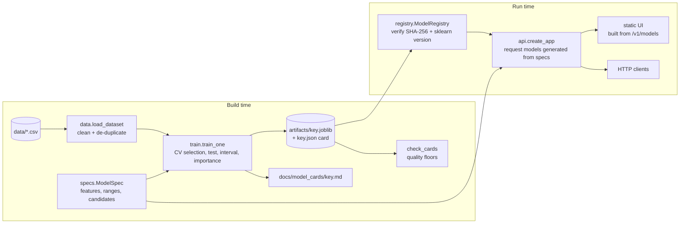

# Architecture

Two phases that share one contract, the `ModelSpec`:

## Why a spec

The original project described each model in four places that could drift apart: the notebook (feature order, encodings such as `Petrol=0, Diesel=1, CNG=2`), `views.py` (`list(data.values())`), six HTML forms and the README. A `ModelSpec` states each feature once (name, label, unit, numeric range or categories, whether it may be missing, an example). From it we derive:

| Consumer | Generated from the spec |
| :-- | :-- |
| Training | column selection, `OneHotEncoder(categories=...)` with fixed categories, imputer for numeric columns |
| API | a pydantic request model per route (`extra="forbid"`, `ge`/`le`, `Literal[choices]`, `allow_inf_nan=False`) and its OpenAPI schema |
| Web UI | form fields, units, bounds and the examples that pre-fill them |
| Model card | the *Inputs* table and the accepted-versus-seen ranges |
| Tests | every example must satisfy its own constraints; every training value must lie inside the declared range |

## Training pipeline

1. `load_dataset` reads the CSVs, applies the dataset-specific cleaner (Pima zeros become missing; exercise and calorie files are joined one-to-one), then removes exact duplicates **before** splitting.
2. 80/20 split with a fixed seed, stratified for classification.
3. For each candidate (`ridge` / `logistic_regression`, `random_forest`, `hist_gradient_boosting`) build `Pipeline([ColumnTransformer(impute+scale, one-hot), estimator])` and run 5-fold CV on the training split. The best by RMSE or ROC AUC wins.
4. Refit on the training split, score the held-out split once next to a `Dummy` baseline.
5. Regression only: out-of-fold residuals give the 5th and 95th percentile offsets, and the test split measures their real coverage.
6. Permutation importance on the test split, in the units of the metric.
7. `joblib.dump`, hash the file, write the JSON card, render the Markdown card.

Choices that were tried and rejected are recorded in the ADRs, for example a log-transformed target.

## Serving

- `ModelRegistry` loads every spec's artifact at start-up. A model is available only if its card exists, the file's SHA-256 matches the card and the scikit-learn version equals the one that trained it. Failures are kept (not raised) so one bad model cannot take the others down, and `/readyz` reports them.
- `predict` builds a one-row `DataFrame` with the spec's column order from named inputs, so the old class of bug (features in client order) cannot occur. It adds extrapolation warnings, clips negative regression outputs to zero and refuses non-finite output.
- Inference uses a single thread: training fits forests with all cores, which only adds start-up cost per one-row request.
- Middleware adds a request id, security headers (`nosniff`, `DENY`, CSP `default-src 'self'`) and logs method, path, status and latency only. A custom validation handler returns just field, message and type.

## Trade-offs

| Decision | Reason | Cost |
| :-- | :-- | :-- |
| Train inside the Docker build | Artifact and runtime always share a scikit-learn version; the gate runs in the build | Slower builds (about a minute) |
| Artifacts are build outputs, not committed | Pickles are version-locked and unreviewable in diffs | Needs `make train` before running or integration tests |
| Joblib with checksum instead of ONNX | Keeps the pipeline (imputer, encoder) in one object, no extra runtime | Only safe because the file is tied to our own card; ONNX would remove the unpickling risk entirely |
| No experiment tracker | CV results for every candidate are in the card, which is committed | No run history across retrains beyond git |
| Gradient boosting from scikit-learn, not XGBoost | One fewer heavy dependency; competitive on these tables | Slightly different results from the original XGBoost models |

See [docs/adr](docs/adr) for the longer records.
